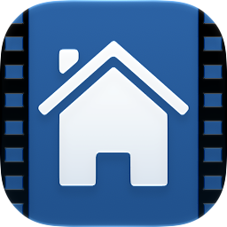

  

<h1 align="center">Holme Theater</h1>

  A native, fully featured Jellyfin client for iPhone, iPad, and Apple TV.

---

Holme Theater is built to feel like it shipped with your device, so your own movies and shows get the same polished experience as everything else on it.

## Features

### Your Home Screen, Your Way
- Continue Watching and Next Up, so you always pick up right where you left off
- Reorder, hide, or combine sections, and turn the featured carousel on or off
- Browse your libraries, collections, and playlists, or search across everything

### Rich Player Experience
- Skip intros, recaps, credits, and previews with one tap
- Jump between chapters
- Choose audio tracks, subtitles, playback speed, and streaming quality
- Image-based PGS and styled SSA/ASS subtitles
- Picture in Picture and AirPlay
- Autoplay the next episode when one ends

### Take It With You
- Download movies, single episodes, or entire seasons to watch offline on iPhone and iPad
- Follow download progress from your Lock Screen with Live Activities
- Your downloads stay available even when your server isn't reachable

### Made For Every Screen
- Designed for iPhone, iPad, and Apple TV, with an interface that feels at home on each
- Rich detail pages with cast and crew, trailers, seasons, and episodes
- Mark items watched, add favorites, and build playlists
- Sign in with Quick Connect, or use your phone to approve sign-ins on other devices

## Requirements

- iPhone or iPad with iOS 26 or later, or Apple TV with tvOS 26 or later
- A [Jellyfin](https://jellyfin.org) media server. Jellyfin is free, open-source software you run on your own computer or server.

## Support

Having trouble, or have an idea? See [Support](SUPPORT.md) for common questions, or email [support@holme.tech](mailto:support@holme.tech). Bug reports and feature requests are welcome in [Issues](https://github.com/JoshuaHolme/HolmeTheater/issues).

## Privacy

Holme Theater doesn't collect any data. It only talks to the Jellyfin server you sign in to. See the [Privacy Policy](PRIVACY.md).

## Building from Source

1. Install Xcode 27 or later.
2. Clone this repository and open `HolmeTheater.xcodeproj`.
3. Xcode fetches the Swift package dependencies, including the [Jellyfin Swift SDK](https://github.com/jellyfin/jellyfin-sdk-swift), on first open.
4. Choose the **HolmeTheater** scheme and an iPhone, iPad, or Apple TV destination, then build and run.

To run on a device, set your own development team and bundle identifier in the target's Signing & Capabilities settings.

## License

Holme Theater's source code is licensed under the [Mozilla Public License 2.0](https://mozilla.org/MPL/2.0/).

---

Holme Theater is an independent app and is not affiliated with or endorsed by the Jellyfin project.
