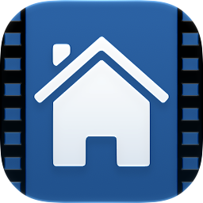

<p align="center">
  
</p>

<h1 align="center">Holme Theater</h1>

<p align="center">
  A native <a href="https://jellyfin.org">Jellyfin</a> client for iPhone, iPad, and Apple TV, written in SwiftUI.
</p>

---

Holme Theater is an independent project and is not affiliated with or endorsed by the Jellyfin project.

## Features

- **Home:** Continue Watching, Next Up, and recently added items, with sections you can reorder, hide, or combine, and an optional featured carousel
- **Browsing:** movie and TV libraries, collections, playlists, genres, cast and crew pages, and search
- **Playback:** AVPlayer, playing files directly when it can and asking the server to remux or transcode to HLS when it can't
- **Player:** skip intros, recaps, credits, and previews; chapters; audio track, subtitle, speed, and quality selection; Picture in Picture and AirPlay; autoplay of the next episode
- **Subtitles:** WebVTT, styled SSA/ASS, and image-based PGS are drawn by the app; other image formats are burned in by the server
- **Downloads:** movies, episodes, or whole seasons for offline viewing, with Live Activity progress on iPhone and iPad (experimental on Apple TV)
- **Sync:** watch progress, watched state, and favorites go back to the server, including progress made offline
- **Sign-in:** username and password or [Quick Connect](https://jellyfin.org/docs/general/server/quick-connect/), and approving Quick Connect codes for other devices
- **Seasonal themes**, which you can turn off, pin, or schedule

Not implemented yet: server discovery on the local network; music, photos, and Live TV; and formats AVPlayer can't
play natively.

## Requirements

- Xcode 27 or later
- iOS / iPadOS 26 or later, or tvOS 26 or later
- A Jellyfin server you can reach from your device or simulator (or none, with the mock service below)

## Building

1. Clone the repository and open `HolmeTheater/HolmeTheater.xcodeproj`. Swift Package Manager fetches the
   dependencies, including [jellyfin-sdk-swift](https://github.com/jellyfin/jellyfin-sdk-swift), on first open.
2. To run on a device, open **Signing & Capabilities** for each target, choose your own development team, and change
   the bundle identifier prefix `tech.holme.theater` to one you own. The simulator doesn't need this.
3. Choose the **HolmeTheater** scheme and an iPhone, iPad, or Apple TV destination, then run.

### Running without a server

Add `-UseMockService` to the scheme's **Run → Arguments**. The mock returns sample movies and shows, plays Apple's
public HLS test stream, and its Quick Connect shows the code `123456` and approves it after a few seconds. Mock runs
keep their saved session separate from real ones. Add `-SignedOutAtLaunch` as well to start at the sign-in screen.

Tips use the local StoreKit configuration in `Products.storekit`, so the Concession Stand works in the simulator
without App Store Connect.

## Architecture

The UI never talks to the Jellyfin SDK directly. Everything goes through one protocol:

| File | Role |
|---|---|
| `Services/MediaService.swift` | The protocol the UI depends on: connect, sign in, browse, search, play, report progress |
| `Services/JellyfinMediaService.swift` (+`Browsing`/`Collections`/`Playback`/`Mapping`) | The real implementation, built on jellyfin-sdk-swift and split by area. The only files that import `JellyfinAPI` |
| `Services/OfflineFallbackMediaService.swift` | Wraps another service and answers from downloads when the server can't be reached |
| `Services/MockMediaService.swift` | Canned data for previews, tests, and UI work without a server |
| `Services/MediaModels.swift` | Plain value types shared by the UI and services (no SDK types) |
| `Services/SessionStore.swift` | Where the signed-in session is kept: the Keychain in the app, in memory in tests |
| `Services/Downloads/` | The background download system, its on-disk index, and Live Activity updates |
| `Services/Subtitles/` | Subtitle parsers (WebVTT, SubStation Alpha, PGS) and the controller that times them to playback |
| `AppModel.swift` | App-wide state: which service is in use and who is signed in |
| `Views/` | SwiftUI screens. These only use `MediaService` and the types in `MediaModels.swift` |
| `DownloadActivity/` | The widget extension that shows download progress as a Live Activity |

Because of this split you can rework the UI without touching networking code, and swap in a different backend
(or a test double) without touching the UI.

Larger areas are split across focused files rather than kept in one place. Logic that can be reasoned about on its
own, such as URL handling, paging, subtitle parsing, the carousel's index maths, and the player's timing, lives in
small value types and pure functions so it can be unit tested without a server or a running view.

## Tests

| Target | Framework | What it covers |
|---|---|---|
| `HolmeTheaterTests` | [Swift Testing](https://developer.apple.com/documentation/testing/) | Server-address parsing, same-origin authorization, access-token URL handling, paging, the subtitle parsers, downloads, offline fallback, settings persistence, tips, and `AppModel`'s session lifecycle |
| `HolmeTheaterUITests` | XCUIAutomation | Signing in and out (password and Quick Connect), browsing, search, downloads, and rotation, on iPhone, iPad, and Apple TV |

Everything runs against the mock service, an in-memory session store, and temporary directories, so no test touches a
real server or the Keychain.

Run the unit tests from Xcode with **Product → Test** (⌘U), or on the command line:

```sh
cd HolmeTheater
xcodebuild test -scheme HolmeTheater -only-testing:HolmeTheaterTests \
    -destination 'platform=iOS Simulator,name=iPhone 17'
```

`Tools/run-ui-tests.sh` runs the UI tests on every installed iPhone, iPad, and Apple TV simulator in every orientation
(using `ReleaseUITests.xctestplan`). A full run takes a couple of hours; the comment at the top of the script lists
its options.

## Security notes

- App Transport Security is relaxed only for local networking (`NSAllowsLocalNetworking`): plain HTTP is allowed to IP
  addresses, `.local` names, and single-label host names, because self-hosted servers on a LAN often don't use TLS.
  Servers reached by a public host name must use HTTPS. When no scheme is typed, HTTPS is tried first, and if only
  HTTP answers, the app asks before sending anything over it.
- The access token is kept in the Keychain. AVPlayer can't attach headers to every HLS segment request, so the token is
  also added to stream and subtitle URLs as an `ApiKey` query parameter. Those URLs are treated as secrets: the token
  is removed before a URL is saved to disk, and authorization is only attached to requests to the server's own origin.
- Logs record paths and error messages, never tokens or query strings.

To report a vulnerability, see [SECURITY.md](SECURITY.md).

## Privacy

Holme Theater has no analytics, ads, tracking, or crash reporting. It only talks to the Jellyfin server you sign in
to. See the [Privacy Policy](HolmeTheater/PRIVACY.md).

## Support

Holme Theater is free and open source, with nothing locked. If it's become part of your movie nights, you can help keep
the projector running by buying the projectionist a snack from the Concession Stand in the app
(Account → Support Holme Theater). Tip as often as you like, or never.

For help, see [Support](HolmeTheater/SUPPORT.md) or open an [issue](https://github.com/JoshuaHolme/HolmeTheater/issues).

## Contributing

Issues and pull requests are welcome. See [CONTRIBUTING.md](CONTRIBUTING.md).

## License

Holme Theater is licensed under the [Mozilla Public License 2.0](LICENSE). It depends on
[jellyfin-sdk-swift](https://github.com/jellyfin/jellyfin-sdk-swift), which is also MPL-2.0.
